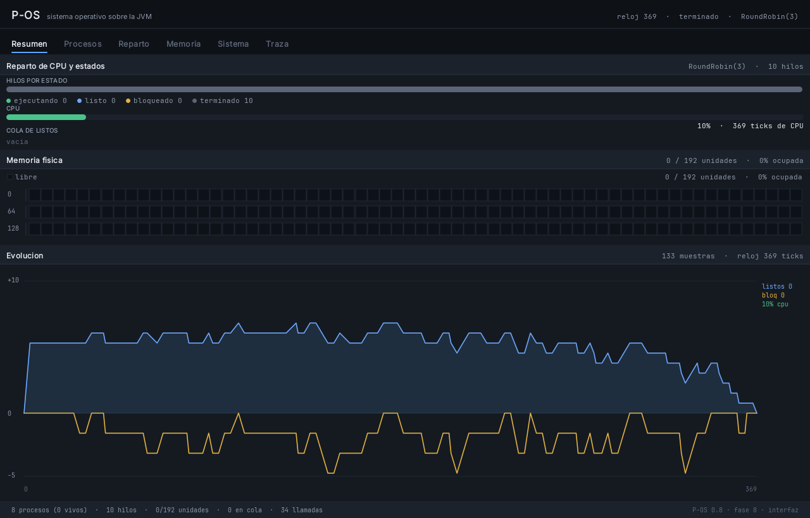
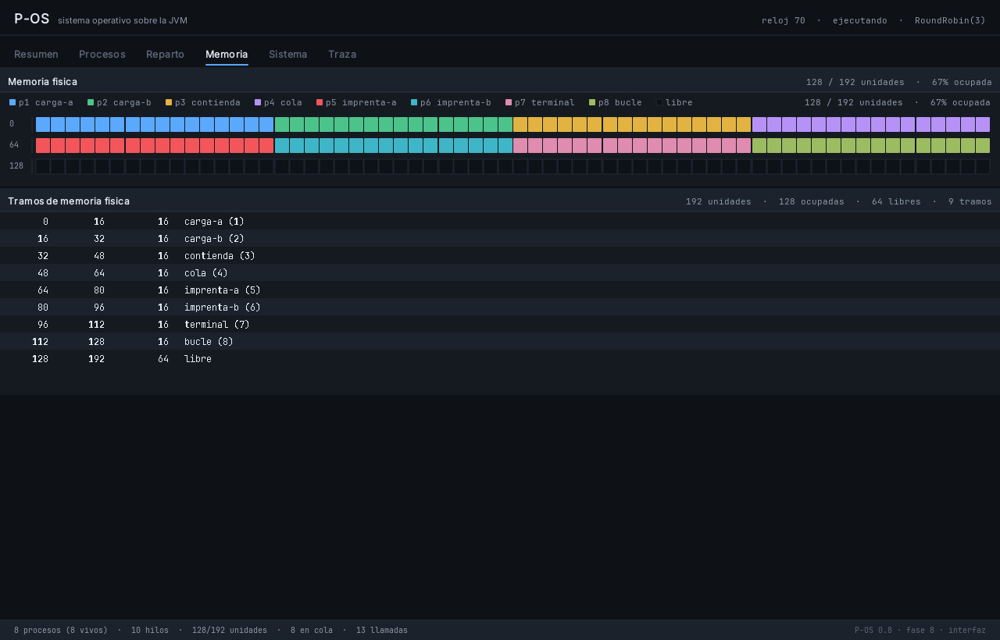

# P-OS

Sistema operativo didáctico en Java para la asignatura de Sistemas Operativos.

No es un simulador que dibuja lo que pasaría: mantiene memoria real por bloques,
procesos e hilos reales sobre hilos de la máquina virtual, un sistema de ficheros
propio con su imagen en disco y una terminal que es un proceso más del sistema,
planificado como cualquier otro.



Las seis vistas de la ventana son la misma foto del sistema mirada desde seis
preguntas distintas. Arriba, el resumen: procesador, mapa de la memoria física y
evolución en el tiempo.

## Arrancar

Requiere **Java 21** y **Maven**. No hay dependencias de ejecución: solo JUnit
para las pruebas.

```bash
mvn test                 # 347 pruebas; imprime las tablas comparativas
mvn package              # genera target/p-os-0.1.0-SNAPSHOT.jar
```

El jar se puede lanzar de dos formas, según lo que se quiera ver:

```bash
java -jar target/p-os-0.1.0-SNAPSHOT.jar --ui        # la ventana, con el sistema corriendo dentro
java -jar target/p-os-0.1.0-SNAPSHOT.jar             # informe de texto: memoria y planificadores
```

Sin pantalla (servidor, contenedor, CI) la ventana no arranca, pero las vistas se
pueden generar como imágenes:

```bash
java -jar target/p-os-0.1.0-SNAPSHOT.jar --captura capturas
```

Eso escribe ocho PNG en la carpeta indicada sin necesitar servidor gráfico: los
paneles se construyen, se les da tamaño y se pintan sobre una imagen.

## Las demostraciones

Cada fase tiene una demostración que se imprime en la terminal y se puede
reproducir sin tocar código. Todas usan el mismo formato: mismo problema, varias
soluciones al lado, y la conclusión escrita.

| Bandera | Qué demuestra |
|---|---|
| *(sin argumentos)* | Diagnóstico de la memoria física y comparación de planificadores |
| `--memoria` | Los tres esquemas de memoria: contiguo, paginado y segmentado |
| `--swap` | Paginación por demanda, área de intercambio y FIFO / LRU / OPT |
| `--disco` | Los tres métodos de asignación de ficheros sobre la misma imagen |
| `--concurrencia` | La carrera que pierde actualizaciones y el cerrojo que la arregla |
| `--sincronizacion` | Semáforos, productor y consumidor, y monitores con condición |
| `--medicion` | Coste en ticks de los tres mecanismos de espera, medido |
| `--medicion --csv` | Lo mismo, en formato de hoja de cálculo |
| `--shell` | Una sesión de terminal sobre una imagen de ficheros |
| `--interactivo` | La misma terminal, pero escribiendo desde el teclado |
| `--ui` | La ventana del simulador |
| `--captura [carpeta]` | Las mismas vistas en PNG, sin pantalla |
| `--traza` | Añade la traza completa de la ejecución Round Robin |
| `--version`, `--help` | Versión y lista de banderas |

## La terminal

`--shell` imprime una sesión ya guionizada, no lee del teclado: es una
demostración más. `--interactivo` es la misma terminal con el teclado de verdad:
escribes una orden, la ejecutas, ves la respuesta y sigues, sin cerrar la sesión
entre orden y orden.

```
java -jar target/p-os-0.1.0-SNAPSHOT.jar --interactivo
java -jar target/p-os-0.1.0-SNAPSHOT.jar --interactivo --imagen /tmp/disco.img
```

Con `--imagen` el disco vive en un fichero: al salir se guarda y la sesión
siguiente encuentra lo que dejó escrito la anterior. Sin esa bandera el disco se
crea al vuelo y se pierde al cerrar.

Lo que se puede probar en una sesión interactiva es lo mismo que en el guion,
pero sin escribir el guion: `ls`, `cat`, tuberías, y sobre todo el control de
trabajos, que es lo que gana con un teclado delante

```
spawn suma /tarea.pos &
jobs
ps
fg
kill %1
```

Las órdenes que entiende el intérprete son estas, las mismas en los dos modos.

| Familia | Órdenes |
|---|---|
| Ficheros | `ls`, `cat`, `cd`, `pwd`, `mkdir`, `touch`, `rm`, `cp`, `mv`, `stat`, `tree`, `df`, `fsck` |
| Texto | `echo`, `head`, `tail`, `wc`, `grep` |
| Composición | `a \| b`, `>`, `>>`, `<` |
| Trabajos | `jobs`, `bg`, `fg`, `stop`, y `&` al final de la línea |
| Procesos | `ps`, `kill`, `spawn`, `sleep`, `clock`, `uptime` |
| Sistema | `mem`, `syscalls`, `method`, `uname`, `version`, `history`, `help`, `clear`, `exit` |

Cada una es una llamada al sistema: el núcleo las cuenta, las atiende y puede
denegarlas. Eso vale también para la propia terminal, que es un proceso y pide
turno como los demás. `help` las describe dentro de la sesión y `method` cambia el
método de asignación, para ver el mismo árbol con los tres.

En el modo guionizado, lo que se puede probar es lo que hay escrito en el guion.
Está en `ShellDemo`, en una lista de líneas: cambiar una orden por otra y volver a
lanzar es todo lo que hace falta para ver qué responde el sistema. En modo
interactivo no hay guion que mirar: se escribe y se ve.

## Cómo está hecho

- **No simula el estado, lo tiene.** Un proceso de P-OS es un objeto con su
  bloque de control, sus hilos y su memoria; un hilo de P-OS corre sobre un hilo
  real de la JVM cuando le toca el procesador. Cuando dos hilos se pelean por un
  contador, la carrera es de verdad y se pierden actualizaciones de verdad.
- **El procesador es explícito.** Hay un único punto donde se decide a quién le
  toca: el planificador. Los hilos de la JVM se crean, pero no avanzan hasta que
  el núcleo se lo permite. Eso hace el sistema reproducible.
- **Cada mecanismo es una interfaz.** Gestores de huecos, traductores de
  direcciones, planificadores y métodos de asignación comparten contrato, así que
  el mismo código corre con varias políticas y las tablas comparan lo mismo. En
  planificación son cuatro: FCFS, round robin, el más corto primero y
  prioridades.
- **Lo que se dibuja es una copia.** La ventana no lee el núcleo mientras corre:
  recibe fotos inmutables y las reparte. Nunca ve un estado a medias, y refrescar
  es barato porque una foto repetida no toca nada.

Los paquetes siguen esa separación:

| Paquete | Contenido |
|---|---|
| `pos.base` | Piezas que usan todos: fallo del sistema, versión, tramos libres |
| `pos.phys`, `pos.alloc` | Memoria física, mapa de marcos y gestores de huecos |
| `pos.mm` | Memoria virtual: contiguo, paginado, segmentado y traducción de direcciones |
| `pos.proc`, `pos.kernel`, `pos.sched` | Procesos, hilos, intérprete, núcleo y planificadores |
| `pos.fs` | Sistema de ficheros, imagen por bloques y métodos de asignación |
| `pos.sync` | Cerrojos, semáforos, variables de condición y monitores |
| `pos.sys`, `pos.shell` | Llamadas al sistema, descriptores y terminal |
| `pos.ui`, `pos.ui.swing` | Fotos del estado, modelos de tabla y la ventana |
| `pos.launch` | Punto de entrada y una demostración por fase |

## Estado

Ocho fases cerradas. El código son unas 19 300 líneas en 113 ficheros, y las
pruebas 6 300 en 24 ficheros: 46 clases contando las anidadas y 347 casos
contando los parametrizados.

| Fase | Contenido | Documento |
|---|---|---|
| 0 | Entorno de compilación y esqueleto | — |
| 1 | Memoria física por bloques y gestores de huecos | [fase-01](docs/fase-01-memoria.md) |
| 2 | Procesos, hilos, intérprete, FCFS y Round Robin | [fase-02](docs/fase-02-procesos.md) |
| 3 | Memoria virtual: contiguo, paginado y segmentado | [fase-03](docs/fase-03-memoria.md) |
| 3b | Páginas por demanda, intercambio y reemplazo | [fase-03b](docs/fase-03b-intercambio.md) |
| 4 | Sistema de ficheros y tres métodos de asignación | [fase-04](docs/fase-04-disco.md) |
| 5 | Cerrojos, exclusión mutua e interbloqueo | [fase-05](docs/fase-05-concurrencia.md) |
| 6 | Semáforos, condiciones y monitores | [fase-06](docs/fase-06-sincronizacion.md) |
| 7 | Llamadas al sistema, descriptores y terminal | [fase-07](docs/fase-07-llamadas.md) |
| 8 | Ventana con seis vistas y capturas sin pantalla | [fase-08](docs/fase-08-interfaz.md) |

Los dos planificadores que faltaban para completar la comparación, SJF y
prioridades, se añadieron al cerrar la fase 8: están descritos en
[`fase-02-procesos.md`](docs/fase-02-procesos.md), sección 4.

## Las vistas

El mapa de la memoria física es la vista que justifica la paginación: una tabla
diría «16 unidades en 4 tramos», que es correcto y no se entiende. Aquí se ve que
esas unidades no están juntas y que la memoria libre queda partida en trozos.



## Documentación

- [`docs/arquitectura.md`](docs/arquitectura.md): el documento de arquitectura.
  Decisiones y su motivo, modelo de ejecución, fases y lo que se descartó.
- [`docs/guia-demostracion.md`](docs/guia-demostracion.md): guion de cinco
  minutos para enseñar el sistema en orden, con qué señalar en cada paso.
- Un documento por fase, enlazado en la tabla de arriba, con lo que se implementó
  y las mediciones que lo sostienen. No solo lo que salió bien: también las
  decisiones que se revirtieron y por qué.

## Convenciones

Comentarios en español y sin emojis. Nombres de clases y métodos en inglés, con
los términos de la asignatura. Lo que ve el usuario, en español, salvo los
nombres de comando. Las pruebas se escriben antes que la demostración, y ninguna
tabla del README lleva cifras que no salgan de una ejecución.
